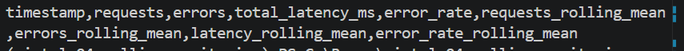

# Rolling Monitoring of System Metrics

Continuous Intelligence | Project 04 | Example Report

## Overview

This project investigates how rolling statistics
can reveal patterns in system behavior over time.

Individual measurements may fluctuate.
Rolling analysis provides a way to examine
recent behavior while reducing short-term variation.

## Data

The example dataset contains 15 time-ordered observations
collected at five-minute intervals.

Each observation includes:

- Timestamp.
- Number of requests.
- Number of errors.
- Total latency in milliseconds.

[View Example Dataset](https://github.com/sandra8918/cintel-04-rolling-monitoring-custom/blob/main/data/system_metrics_timeseries.csv)

## Methods

The pipeline sorts observations by timestamp
and computes rolling averages using a window
of three observations.

Rolling averages are calculated for:

- Requests.
- Errors.
- Total latency.

Each completed window summarizes the current
observation and the two preceding observations.

The first two rows have no rolling average
because the full window is not yet available.

## Results

The rolling metrics show several changes in activity.

| Time  | Rolling Requests | Rolling Errors |
| ----- | ---------------: | -------------: |
| 08:10 |           135.00 |           3.00 |
| 08:25 |           171.67 |           6.00 |
| 08:50 |           145.00 |           2.33 |
| 09:10 |           198.33 |           7.67 |

[View Rolling Monitoring Results](https://github.com/sandra8918/cintel-04-rolling-monitoring-custom/blob/main/artifacts/rolling_metrics.csv)

## Interpretation

The rolling averages reveal periods of increasing
activity, declining activity, and renewed growth.

Toward the end of the observation period,
request counts and error counts both increase.

This suggests that growing workload may coincide
with additional errors, although the data
does not establish a causal relationship.

## Limitations

Rolling averages smooth short-term variation,
but may delay detection of sudden changes.

The example uses a fixed three-observation window.
Different window sizes may reveal different patterns.

The pipeline does not yet classify anomalies
or issue monitoring alerts.

## Conclusion

Rolling monitoring adds a temporal perspective
to system analysis.

It provides a foundation for identifying developing
patterns and determining when further investigation
may be useful.

## Documentation Index

- **Home** - this landing page
- [**Project Instructions**](project-instructions.md)
- [**Glossary**](glossary.md)
- [**API**](api.md)
- [**Reactive App**](./app/index.html)

## Project Links

- [GitHub Repository](https://github.com/sandra8918/cintel-04-rolling-monitoring-custom)
- [Example Pipeline](https://github.com/sandra8918/cintel-04-rolling-monitoring-custom/blob/main/src/cintel/rolling_monitor.py)
- [Results and Artifacts](https://github.com/sandra8918/cintel-04-rolling-monitoring-custom/tree/main/artifacts)

## Project Resources

- [Project Instructions](project-instructions.md)
- [Professional Python Guide](https://denisecase.github.io/pro-analytics-02/)
- [Professional Python Project Explainer](https://pup-pack.github.io/professional-python-project-explainer/).
- [Suggested Datasets](https://denisecase.github.io/pro-analytics-02/reference/datasets/cintel/)

## D2 Technical Experiment

The original project used a rolling window of 3 observations. I changed the
window size to 5 observations to test whether a larger window would produce
smoother results.

I predicted that the five-observation window would reduce short-term
fluctuations but respond more slowly to sudden changes.

After rerunning the project, the pipeline completed successfully and created
the rolling metrics artifact. The larger window produces smoother averages.
This experiment showed that window size affects the balance between
responsiveness and stability.

## D3 Custom Application: Reliability Monitoring

### 1. New problem or question

I wanted to determine when system reliability worsens by analyzing the
rolling error rate instead of looking only at the total number of errors.

### 2. Data used

I used the time-series system metrics dataset in this project. Each record
contains a timestamp, number of requests, number of errors, and total
latency.

[View the project dataset](https://github.com/sandra8918/cintel-04-rolling-monitoring-custom/blob/main/data/system_metrics_timeseries.csv)

### 3. Techniques and tools

I used Python, Polars, uv, and rolling-window calculations. I calculated
error rate using:

error rate = errors / requests

I then calculated a rolling error-rate average using a five-observation
window. I also used Git, pytest, and Zensical to test and document the work.

### 4. Difference from the example

The original example focused on rolling averages for requests, errors, and
latency. My custom analysis focuses on system reliability by calculating the
percentage of requests that resulted in errors and then smoothing that
percentage over time.

### 5. Finding or insight

The rolling error rate makes reliability patterns easier to see because it
reduces the effect of one unusual observation. The five-observation window
produces a smoother signal, but it responds more slowly to sudden changes.

### 6. Limitation

The dataset is small and represents only a limited period of time. The
analysis also does not include a production alert threshold or information
about the cause of each error. A larger dataset and a defined service-level
threshold would improve the analysis.

## Visual Evidence

The artifact below shows the calculated error rate and rolling error-rate
columns produced by the customized monitoring pipeline.

